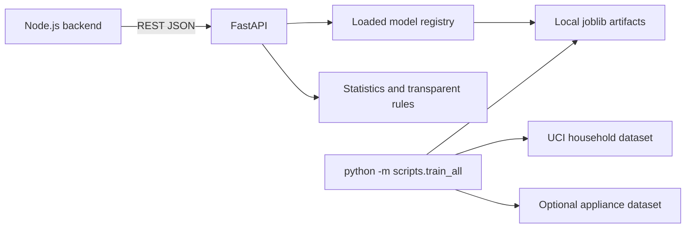

# EnergyIQ ML Service

EnergyIQ is a standalone Python service for household electricity analytics. It provides short-term active-power forecasting, unusual-reading detection, peak-period analysis, consumption statistics, descriptive daily clustering, evidence-based recommendations, and an optional appliance-energy estimator. It does not replace the Node.js application's authentication, authorization, or database responsibilities.

## Architecture



The API is stateless and loads artifacts once when `app.api.routes` initializes. Training and dataset downloads are explicit offline commands; API requests never download data or retrain models.

## Python environment and installation

Python 3.11 or newer is recommended; Python 3.12 is supported.

```powershell
py -3.12 -m venv .venv
.\.venv\Scripts\Activate.ps1
python -m pip install -r requirements.txt
```

Copy `.env.example` to `.env` and adjust paths/configuration as needed. The application reads environment variables directly; the file is an example and is not automatically loaded. Set variables in the shell or use your preferred environment-file loader.

## Datasets and units

The repository includes three untracked datasets:

| File | Use | Notes |
|---|---|---|
| `household_power_consumption.txt` | Primary household model | UCI Individual Household Electric Power Consumption, semicolon-delimited; active power is kW |
| `energydata_complete.csv` | Optional appliance-energy model | UCI Appliances Energy Prediction; separate target and features; target is Wh per 10-minute interval |
| `Tetuan City power consumption.csv` | Not currently used | Separate zone-level dataset with a different schema and power scale; not treated as household readings |

Do not combine those datasets. To download the UCI datasets explicitly into the repository root (the default configured paths):

```powershell
python -m scripts.download_data household
python -m scripts.download_data appliances
```

If downloading is blocked, download the corresponding archives from the UCI pages:

- https://archive.ics.uci.edu/dataset/235/individual+household+electric+power+consumption
- https://archive.ics.uci.edu/dataset/374/appliances+energy+prediction

Place `household_power_consumption.txt` and/or `energydata_complete.csv` in the repository root, or set `ENERGYIQ_DATASET_PATH` and `ENERGYIQ_APPLIANCE_DATASET_PATH`. The loader recognizes `?`, empty and malformed numeric cells, removes duplicate timestamps, sorts chronologically, and reports missing records. Missing time intervals are not filled with fabricated observations.

Canonical reading fields include `timestamp`, `active_power_kw`, `reactive_power`, `voltage_v`, `current_a`, `energy_kwh`, `sub_metering_1`–`sub_metering_3`, `temperature`, and `humidity`. The UCI `Global_active_power` maps to `active_power_kw` in kW; it is not energy. Sub-metering values are retained as documented readings and are not interpreted as kW. Energy derived from power is explicitly labelled estimated and integrated over elapsed time.

Naive API timestamps are interpreted as UTC. Timezone-aware timestamps are normalized to UTC. The UCI dataset has no timezone metadata, so this service preserves its encoded wall-clock values and treats them as UTC; that is a modeling assumption, not an independently verified source timezone. Convert other local utility timestamps to UTC before submitting them.

## Train and evaluate

Train all eligible models:

```powershell
python -m scripts.train_all
```

This loads the configured household data and independently attempts forecasting, Isolation Forest anomaly detection, hourly peak prediction, daily KMeans clustering, and optional appliance regression. Optional model failures are logged and do not hide core model outcomes. Models and metadata are written under `artifacts/` (ignored by Git).

```powershell
python -m scripts.evaluate_models
```

Forecast, peak, and appliance regression metrics use chronological held-out data. Forecasting reports MAE, RMSE and R² against persistence. Anomaly detection is unsupervised; without genuine labels, no accuracy/precision/recall claim is made. Clustering reports cluster sizes, profiles and silhouette score when defined. Public research data metrics are not guarantees for a new household or future time periods; seasonal drift and dataset differences matter. Retrain explicitly with `python -m scripts.train_all` after replacing the input data.

Final evaluation on the supplied local datasets:

| Model | Held-out MAE | RMSE | R² | Notes |
|---|---:|---:|---:|---|
| One-minute Random Forest forecast | 0.077720 kW | 0.211385 kW | 0.944360 | Lower RMSE / higher R² than persistence, but **higher MAE** |
| One-minute persistence forecast | 0.071893 kW | 0.221483 kW | 0.938917 | Lower MAE than the Random Forest on this chronological test window |
| Next-hour peak Random Forest | 0.733645 kW | 1.025577 kW | 0.399397 | Better than previous-hour peak baseline |
| Appliance target Random Forest | 55.138113 Wh | 95.867563 Wh | -0.108902 | Negative R²; do not treat as a reliable estimate |

The forecast evaluation used 409,436 held-out one-minute examples from the primary UCI household file. The peak model used 34,141 valid hourly examples. The appliance model used a separate chronological 80/20 split of 19,735 UCI appliance dataset rows. The forecast ML model does not dominate persistence across metrics, and the appliance model underperforms its test-set mean baseline by R²; these results are reported without claiming improvement.

## Start the API

```powershell
python -m uvicorn app.main:app --host 127.0.0.1 --port 8000
```

Open Swagger UI at `http://127.0.0.1:8000/docs` or the OpenAPI schema at `http://127.0.0.1:8000/openapi.json`. The default binds only to loopback. Production deployment should add authentication, network restrictions, request limits, and resource controls before exposing the service outside a trusted internal network. CORS is not enabled; the intended caller is the server-side Node.js backend.

### Endpoints

All readings use the canonical schema, including required `timestamp` and `active_power_kw` (kW). Request batches are capped by `ENERGYIQ_MAX_BATCH_SIZE` (default 10,000). Forecasting additionally requires 30 consecutive, regularly spaced readings.

| Method | Endpoint | Purpose |
|---|---|---|
| GET | `/health` | Service and model readiness |
| GET | `/models/status` | Artifact availability and metadata |
| POST | `/predict/consumption` | Forecast up to the configured horizon; multi-step predictions are recursive |
| POST | `/detect/anomalies` | Isolation Forest scores and contextual explanations |
| POST | `/predict/peak` | Historical peaks, next-hour peak estimate and configurable threshold comparison |
| POST | `/analyze/patterns` | Statistics, daily/hourly summaries and optional learned cluster assignment |
| POST | `/recommendations` | Transparent, evidence-based rule recommendations |
| POST | `/analyze` | Unified analysis; unavailable model components are reported independently |
| POST | `/data/validate` | Canonical schema, interval and data-quality summary |
| POST | `/predict/appliances` | Optional UCI Appliances target forecast; requires outdoor temperature and humidity |

Example forecast request:

```json
{
  "readings": [
    {"timestamp": "2026-10-23T10:00:00Z", "active_power_kw": 0.42},
    {"timestamp": "2026-10-23T10:01:00Z", "active_power_kw": 0.44}
  ],
  "horizon_steps": 1,
  "interval_minutes": 1
}
```

This shortened example is illustrative; a usable forecast request needs at least 30 consecutive readings and a trained forecasting artifact. A successful response includes predicted kW, timestamp, persistence baseline, model/version and warnings. The model currently supports the one-minute interval used for primary UCI training; an unsupported interval is rejected rather than silently misrepresented.

Example of the response shape, captured from a local smoke test using 100 actual UCI household readings (results will vary with input and retrained artifacts):

```json
{
  "status": "success",
  "latest_observed_active_power_kw": 3.434,
  "predictions": [
    {
      "active_power_kw": 3.344392258540606,
      "timestamp": "2006-12-16T19:04:00+00:00",
      "horizon_steps": 1,
      "persistence_baseline_kw": 3.434,
      "absolute_difference_from_baseline_kw": 0.08960774145939432
    }
  ],
  "unit": "kW",
  "model": {"name": "random_forest", "version": "1.0"},
  "warnings": []
}
```

`/analyze` accepts the same readings plus optional `tariff_inr_per_kwh`, `horizon_steps`, `interval_minutes`, `peak_window_start_hour`, and `peak_window_end_hour`. Cost estimates are only returned when a user-supplied tariff is available. No appliance identity, tariff, weather, or savings amount is inferred from aggregate power data.

## Node.js integration

The production EnergyIQ Node backend lives in `backend/`. Its `src/services/ml.service.js` adapter uses `ML_SERVICE_URL` (default `http://127.0.0.1:8000`), maps UCI meter columns to this service's canonical reading schema, validates the actual forecast/anomaly response payloads, and checks that both required model artifacts are ready. Start the Python API and the Node backend as separate processes. The standalone `examples/node_integration.js` remains a lightweight reference router for additional ML endpoints; it is not the main application.

## Synthetic demo

Synthetic data is clearly labelled and is never used as a substitute for real model training:

```powershell
python -m scripts.generate_demo_data --rows 120
python -m scripts.generate_demo_data --rows 10 --send --url http://127.0.0.1:8000
```

The optional live mode sends generated readings sequentially to `/data/validate`.

## Tests

```powershell
python -m pytest
```

Tests use deterministic, small synthetic fixtures and do not download datasets.

## Evaluation limitations and extension points

- Recursive multi-step forecasts can accumulate error. The primary forecast target is next-interval active power, not energy.
- Forecast model training and evaluation use the household dataset's one-minute readings; non-regular intervals are excluded from supervised examples.
- Peak prediction is household-level and forecasts the next hourly maximum. It does not predict grid-wide demand.
- Isolation Forest identifies unusual patterns, not faults, theft, or unsafe wiring.
- Clusters describe similarity to learned daily profiles, not verified lifestyle categories.
- The appliance model predicts the UCI dataset's aggregate appliance-energy target, not an appliance identity in a household meter.
- Energy from power is trapezoidally integrated over observed elapsed time. Long gaps make such estimates less certain and are warned about.
- The Tetouan data file has not been adapted or trained on. A future dataset adapter should explicitly map units, timestamps and sampling resolution before training.
- A live utility or smart-meter integration requires authorized access and a documented protocol. No private-utility scraping is implemented.
- Adding a dataset requires an explicit loader mapping to canonical fields, documented units, interval validation, chronological evaluation and retraining; do not reuse models across incompatible units.

## Deployment notes

Keep the service on a private network or loopback unless protected by authentication and network policy. The Node.js backend should validate and authorize users before forwarding readings. Do not submit arbitrary filesystem paths or serialized artifacts via API. Joblib artifacts are trusted local files and must only be created by the controlled training process.
